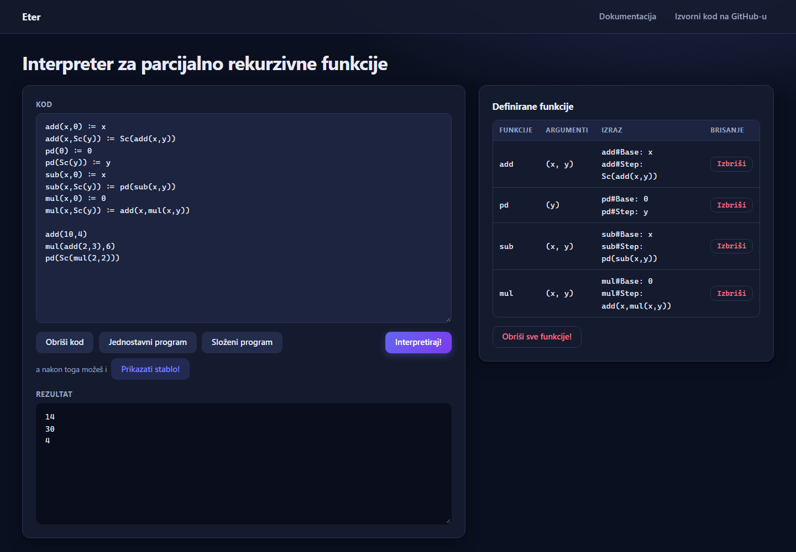
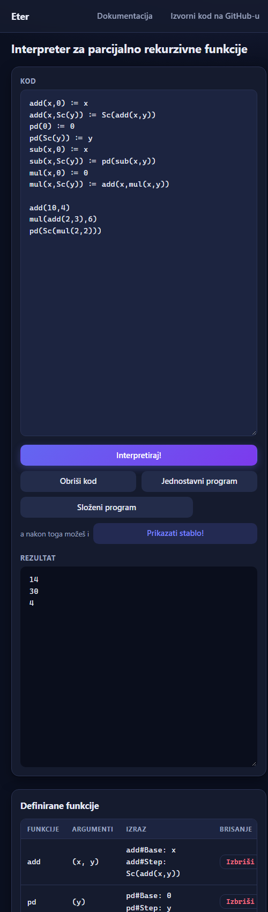

# Interpreter za parcijalno rekurzivne funkcije

Interpreter jednostavnog funkcijskog jezika za definiranje **parcijalno rekurzivnih funkcija** (inicijalne funkcije, kompozicija, primitivna rekurzija, minimizacija, brojeća funkcija, grananje, infiksni operatori i logički izrazi). Napisan je u Pythonu, a pomoću biblioteke PyScript pokreće se izravno u web pregledniku pod nazivom **Eter**.

Projekt je nastao u sklopu diplomskog rada.

**Eter online:** [eteragit.github.io/Eter](https://eteragit.github.io/Eter/)



<p align="center">
  
</p>

## Napomena o stanju repozitorija

U trenutku obrane diplomskog rada repozitorij je izgledao kao u commitu
[`5124e46603200aa75e27864d6d336b66a791e9e8`](https://github.com/EteraGit/InterpreterFunkcijskogJezika/commit/5124e46603200aa75e27864d6d336b66a791e9e8).
Naknadno je **samo vizualno poboljšan** (HTML/CSS web sučelja Etera, responzivan prikaz za monitore i mobitele te tamna/svijetla tema). Funkcionalnost interpretera (Python/JS/PyScript) nije mijenjana.

## Struktura repozitorija

| Mapa | Opis |
| --- | --- |
| `src/` | Izvorni kod interpretera u Pythonu: lekser (`Lekser.py`), parser (`Parser.py`), apstraktno sintaksno stablo i izvršavanje (`AST.py`), tokeni (`Token.py`) te pomoćna biblioteka `vepar.py`. |
| `Eter/` | Web verzija interpretera (HTML + PyScript): `index.html` (sučelje), `Interpreter.html` (dokumentacija jezika), `eter.css` i `styles.css` (stilovi). |
| `doc/` | Dokumentacija jezika. |
| `Inputs/` | Primjer programa u funkcijskom jeziku. |
| `PDF-ovi/` | Dokumenti vezani uz diplomski rad. |
| `slike/` | Slike korištene u ovom README-u. |

## Primjer programa

```
add(x,0) := x
add(x,Sc(y)) := Sc(add(x,y))

mul(x,0) := 0
mul(x,Sc(y)) := add(x,mul(x,y))

add(10,4)            // 14
mul(add(2,3),6)      // 30
```

Cjelovitu dokumentaciju jezika možete pronaći u [Eter/Interpreter.html](Eter/Interpreter.html) (ili online na [eteragit.github.io/Eter/Interpreter.html](https://eteragit.github.io/Eter/Interpreter.html)).
